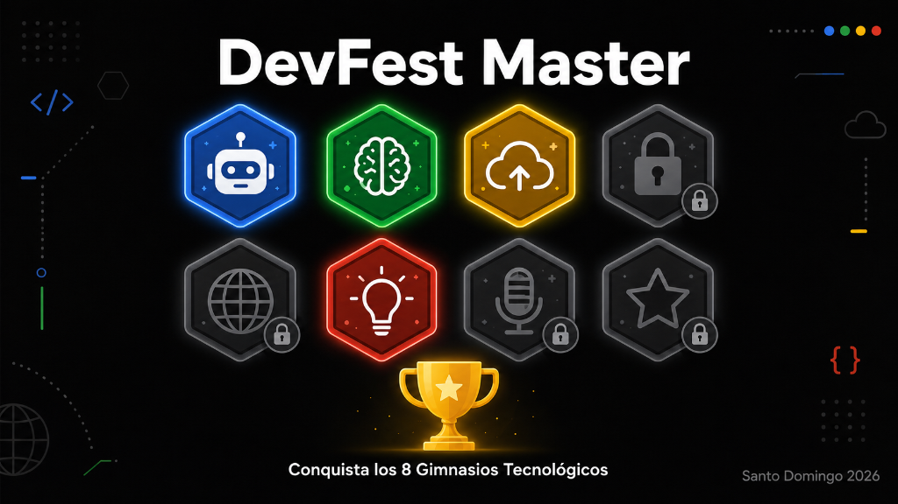

# DevMaster: DevFest Quest

Experiencia gamificada creada para **DevFest Santo Domingo 2026**. Los
participantes recorren ocho gimnasios tecnológicos, completan trivias,
acertijos y minijuegos, coleccionan medallas y aparecen en el ranking del
evento.

[Abrir demo](https://demo-dev-tesoros.netlify.app/) ·
[Agenda día 1](https://devfest.gdgsantodomingo.org/schedule?day=1) ·
[Agenda día 2](https://devfest.gdgsantodomingo.org/schedule?day=2) ·
[Enviar feedback](https://docs.google.com/forms/d/e/1FAIpQLSeKLBT0vCD3AFrohM0BsSczxC-WicESU04z3HLXInMmx4YCng/viewform?usp=publish-editor)



## La experiencia

- Registro simple mediante nombre y alias, sin contraseña para participantes.
- Panel **DevMaster** con rango, puntos, tiempo, medallas y los ocho gimnasios.
- Preguntas asignadas dinámicamente para que los participantes no reciban
  siempre el mismo reto.
- Minijuegos táctiles adaptados a teléfonos y navegador.
- Ranking precargado por puntos, medallas y tiempo.
- Panel de staff para administrar el evento, participantes, medallas y puntos.
- Demo local precargado con el ranking del evento; los cambios se guardan solo
  en el navegador o dispositivo actual.
- Aplicación web instalable como PWA.
- Diseño oscuro, responsive y medallas propias para cada track.

## Gimnasios

| Gimnasio | Track | Mecánica | Cómo se completa |
|---|---|---|---|
| **Debug Droid** | Android / KMP | Reto de código | Responder correctamente 4 preguntas de Android y Kotlin. |
| **Prompt Master** | IA | Trivia | Resolver 4 preguntas aleatorias sobre IA generativa, agentes y prompting. |
| **The Hidden Exploit** | Security | Búsqueda con QR | Encontrar 5 QR físicos y reconstruir el código de seguridad dentro de la app. |
| **Pixel Perfect** | Web / UI | Minijuego visual | Memorizar colores y acertar al menos 5 de 10 rondas; los aciertos adicionales otorgan puntos extra. |
| **Runway Rush** | Startup | Minijuego arcade | Mover la startup entre carriles y lanzar MVPs contra oleadas aleatorias antes de perder el runway. |
| **Scale the Cloud** | Cloud / Firebase | Trivia | Resolver 4 preguntas sobre arquitectura cloud y servicios de Firebase. |
| **Hall of Voices** | Speakers | Adivina quién | Identificar por escrito a 2 speakers aleatorios usando pistas basadas en la agenda. |
| **Community Signal** | Comunidad | Misión social | Unirse a GDG Santo Domingo, obtener la entrada del evento y validar ambas acciones con el staff. |

Los códigos y payloads operativos de los QR se mantienen fuera de este README
para no revelar las soluciones durante el evento.

## Stack

- Flutter y Dart.
- Material 3.
- Cloud Firestore y Firebase Authentication opcionales para conectar un
  proyecto propio.
- `mobile_scanner` para los retos con QR.
- `shared_preferences` para conservar la sesión local del dispositivo.
- `url_launcher` para agenda, comunidad, redes y feedback.
- Web/PWA desplegable en Netlify.

## Arquitectura

El proyecto usa una separación por capas:

```text
UI → AppController/AppScope → casos de uso → repositorios → fuente de datos
```

```text
lib/
├── app/                  # composición de dependencias y arranque
├── core/                 # tema, utilidades y widgets compartidos
├── data/
│   ├── datasources/      # Firestore y fuente local para modo offline
│   ├── local/            # persistencia de sesión en el dispositivo
│   └── repositories/     # implementación de los contratos del dominio
├── domain/
│   ├── entities/         # evento, participante, gimnasio, intento, etc.
│   ├── repositories/     # interfaces de datos
│   └── use_cases/        # registro, retos, descubrimiento y ranking
├── state/                # controlador central e inyección hacia la UI
└── ui/screens/           # participante, gimnasios, retos, ranking y admin
```

Por defecto, `DevFestRoot` inicia un demo local con nombres y apodos
reemplazados. No se conecta a ningún servicio de Firebase.

## Requisitos

- Flutter 3.44 o una versión compatible con Dart 3.12.
- Chrome para desarrollo web.
- Android SDK o Xcode para ejecutar en dispositivos móviles.
- (Opcional) Un proyecto Firebase propio para habilitar sincronización remota.

## Ejecutar localmente

```bash
git clone https://github.com/neryad/devfest_treasure_hunt.git
cd devfest_treasure_hunt
flutter pub get
flutter run
```

Para elegir un destino específico:

```bash
flutter devices
flutter run -d chrome
flutter run -d <device-id>
```

Para probar en un teléfono físico, la opción recomendada es conectarlo por USB,
habilitar el modo de desarrollo y ejecutarlo directamente con `flutter run`.
El acceso a la cámara desde una web requiere un contexto seguro (`https` o
`localhost`), por lo que los QR deben validarse desde el build publicado o una
instalación móvil.

## Firebase y persistencia

El demo usa `assets/demo/devfest-2026.json` como datos iniciales y
`SharedPreferences` para guardar los cambios en el navegador o dispositivo
actual. Los datos no se sincronizan entre visitantes; cada navegador o
dispositivo mantiene su propia copia y sus propios cambios.

Para probarlo como participante, abre la demo, escribe cualquier nombre y un
alias en el formulario de registro y selecciona **Iniciar aventura**. Los
participantes no tienen cuenta ni contraseña. La lista precargada del ranking
es una instantánea histórica del evento, no un ranking compartido en vivo.

El archivo de demo reemplaza los nombres y apodos, pero conserva datos
históricos como identificadores, puntuaciones, progreso, fechas y respuestas a
retos. Se incluye en la aplicación web publicada y cualquier visitante puede
descargarlo. Antes de reutilizar o redistribuir esos datos, verifica que tienes
autorización para publicarlos. Para restaurar la instantánea inicial del demo,
entra al panel Staff, pulsa el botón de restablecer y escribe `RESET`; esto solo
afecta el navegador o dispositivo actual.

El panel Staff del demo es solo una barrera de navegación pública; no protege
información remota. Credenciales:

```text
Usuario: demo@devfest.test
Contraseña: devfest-demo
```

Cualquier persona puede encontrarlas en el código y los cambios solo afectan
sus datos locales. No reutilices esta cuenta para producción.

### Conectar un proyecto Firebase propio

1. Crea un proyecto Firebase y registra una app para cada plataforma que uses.
2. Copia `firebase-config.example.json` a `firebase-config.json` y completa los
   valores de configuración de Firebase de tu proyecto. Este archivo está
   ignorado por Git. La configuración Firebase de cliente no es una contraseña;
   la seguridad de los datos depende de las reglas de Firestore y
   Authentication.
3. Activa Firestore y el proveedor de correo/contraseña de Firebase
   Authentication. Crea las cuentas staff en Firebase Console y configura
   reglas de Firestore antes de publicar.
4. Ejecuta con Firebase explícitamente habilitado:

   ```bash
   flutter run -d chrome --dart-define-from-file=firebase-config.json
   ```

   Para publicar, compila con los mismos defines:

   ```bash
   flutter build web --release \
     --dart-define-from-file=firebase-config.json
   ```

El archivo de configuración debe incluir `"USE_FIREBASE": "true"` para usar
Firestore; sin esa opción, la app permanece en modo demo local. Una base nueva
se inicializa con los gimnasios del proyecto. El JSON de resultados del demo
no se carga automáticamente en Firebase.

Al habilitar Firebase, la fuente Firestore usa el evento `devfest-2026`:

```text
events/devfest-2026
├── treasures
├── participants
├── discoveries
└── attempts
```

La definición base de los gimnasios se encuentra en
`lib/data/datasources/mock_data.dart`. La identificación de sesión se conserva
en el dispositivo mediante `SharedPreferences`.

> Antes de publicar una instancia propia, configura reglas de Firestore que
> impidan escrituras no autorizadas. Este repositorio no incluye un archivo
> `firestore.rules`.

## Pruebas

```bash
flutter analyze
flutter test
```

La suite cubre casos de uso, persistencia, selección de preguntas, respuestas
incorrectas, administración y los principales flujos de widgets y minijuegos.

## Build web y Netlify

Genera la versión de producción con:

```bash
flutter build web --release
```

Publica la carpeta `build/web` completa en un deploy nuevo. No mezcles archivos
de builds distintos ni reemplaces solamente `main.dart.js`, porque los plugins
de Flutter Web pueden quedar desincronizados.

Para actualizar el demo en Netlify mediante despliegue manual:

1. Ejecuta `flutter build web --release` sin `--dart-define-from-file`; así se
   compila el modo demo local.
2. En Netlify, crea un deploy manual subiendo el contenido completo de
   `build/web` (no la carpeta del repositorio ni solo `main.dart.js`).
3. Espera a que el deploy termine y recarga el sitio con una recarga completa.
   Si instalaste la PWA o sigue apareciendo el error de conexión de la versión
   anterior, actualiza la PWA o borra los datos del sitio y vuelve a abrirlo.

Para publicar una instancia conectada a tu Firebase, compila usando
`--dart-define-from-file=firebase-config.json` como se describe arriba y publica
ese build en un sitio separado o en el destino que corresponda. Agrega el
dominio publicado a **Authentication > Settings > Authorized domains** en tu
proyecto Firebase.

## Enlaces

- [Repositorio](https://github.com/neryad/devfest_treasure_hunt)
- [DevFest Santo Domingo](https://devfest.gdgsantodomingo.org/)
- [GDG Santo Domingo en Instagram](https://www.instagram.com/gdgsantodomingo/)
- [GDG Santo Domingo en LinkedIn](https://www.linkedin.com/company/gdgsantodomingo/)
- [Código de conducta](https://devfest.gdgsantodomingo.org/code-of-conduct)

## Créditos

Creado con amor por y para la comunidad por **Dayern Gomez (Neryad)**, Mobile
Developer — “Edad de senior, corazón de junior y curiosidad de trainee”.

Gracias al equipo de **GDG Santo Domingo** y a **Eury Pérez** por la oportunidad
de convertir esta idea en una experiencia para DevFest Santo Domingo 2026.

[GitHub](https://github.com/neryad) ·
[LinkedIn](https://www.linkedin.com/in/dayern-gomez) ·
[YouTube](https://www.youtube.com/@neryad) ·
[X / Twitter](https://x.com/NeryadG) ·
[Instagram](https://www.instagram.com/neryad_dev/)
